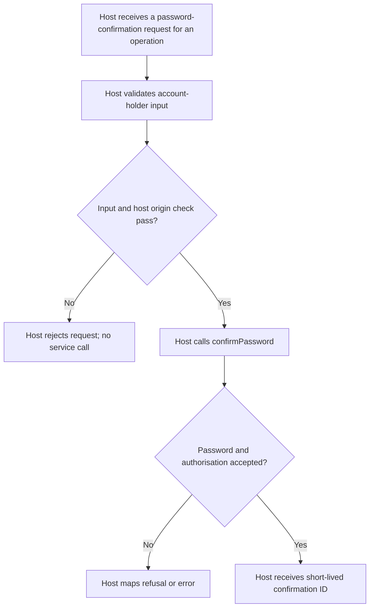
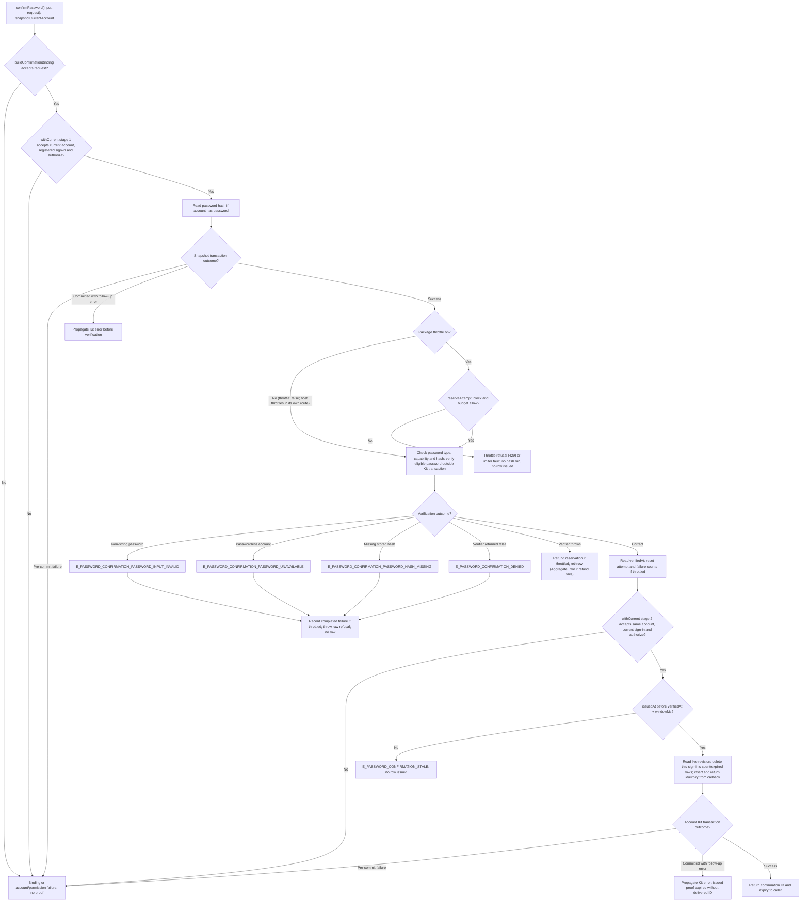

# US-CONFIRM-01 — Issue a confirmation after re-entering the password

As a signed-in account holder, I want to confirm my password for a named sensitive operation so that the application can require recent proof before it changes important data.

**Status:** Current, for a current Account Kit session with session management enabled.
**Access:** Account Kit session sign-in with a server-side session store (the cookie store keeps a copied session alive after sign-out, so the sign-out guarantee in [US-CONFIRM-03](US-CONFIRM-03-revoke-confirmations.md) needs a server-side store; [README requirements](../README.md#requirements)); access tokens are refused because they have no sign-in row. Host must reject foreign-origin issuance requests before invoking the service.
**Entry:** Host-owned issuance endpoint calls `passwordConfirmations.confirmPassword(input, request)`; the package has no HTTP control.
**Documentation:** [README usage and host requirements](../README.md#use)
**Source:** [`PasswordConfirmations.confirmPassword`](../src/password_confirmations.ts)
**Coverage:** [`tests/password_confirmations.spec.ts`](../tests/password_confirmations.spec.ts)

## Acceptance criteria

- The host supplies the operation name (`action`) and resource key (`scope`) as strings of 1–255 characters, a required intent made only of plain JSON values (finite numbers and safe integers; hashed inside an `{action, scope, intent}` wrapper, so it may nest at most 31 container levels around a value, and a value at depth 33 or deeper is refused), and the password string. These are API inputs, not package-rendered form fields.
- When configured, the [host authorisation callback](US-CONFIRM-09-register-authorization.md) runs before password verification and again before issue; anything other than literal `true` refuses. It receives the Kit context and only `{ action, scope, intent }`, never the password. The proof is bound to the operation, not a permission grant; keep the intent unchanged after the call starts.
- If Account Kit reports `E_ACCOUNT_KIT_POST_COMMIT` while taking the stage-one snapshot, issuance stops before verification. If issuance committed and then reports this error, the host has no ID to return. Ask for a fresh confirmation and let the orphan expire. [README errors](../README.md#errors)
- A correct password returns `confirmationId` and `expiresAt`; malformed/wrong password, stale verification, missing sign-in registry, refusal or exhausted throttle returns an error and issues nothing.
- Default failed-attempt budget is 5 per account per minute, then a 20-minute block; `throttle: false` requires host throttling reserved before hash verification.

- The service snapshots the current account input before either Kit transaction. A passwordless account, missing hash or non-string password has its own raw refusal (`E_PASSWORD_CONFIRMATION_PASSWORD_UNAVAILABLE`, `E_PASSWORD_CONFIRMATION_PASSWORD_HASH_MISSING` or `E_PASSWORD_CONFIRMATION_PASSWORD_INPUT_INVALID`). A verifier returning false throws `E_PASSWORD_CONFIRMATION_DENIED`. All four consume the same throttle attempt and deliberately share the public denied response to conceal password capability and verifier state. The verifier runs outside the transaction. A successful check starts the window before limiter cleanup, then the service reacquires the same account, checks permission again and persists the deadline. The returned `expiresAt` is epoch milliseconds.
- Only the JSON projection contributes to the intent hash. Object keys sort by UTF-16 code units and array order matters. Unsupported values, sparse arrays, unsafe integers and nesting beyond depth 32 are refused. Negative zero hashes as zero. Use strings for identifiers outside the safe integer range. [Binding rules and edge cases](../tests/intent_hash.spec.ts)

## User flow

## Code flow

Scope: package service path; HTTP request validation, origin checks and response mapping remain host-owned.

**Code references:** [Entry/service and attempt reservation](../src/password_confirmations.ts), [request binding](../src/intent_hash.ts), [return and config types](../src/types.ts)
