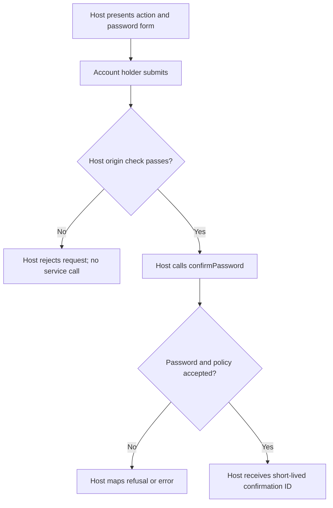
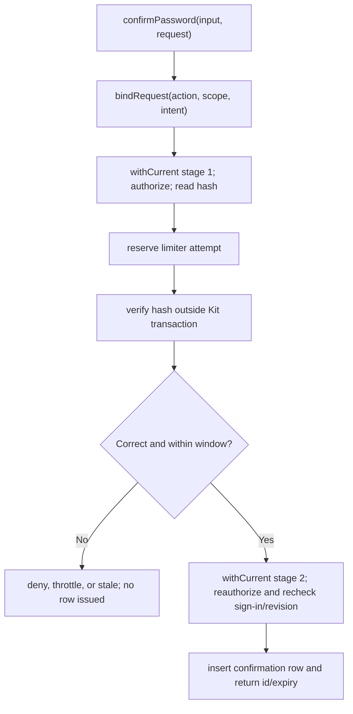

# US-CONFIRM-01 — Issue a confirmation after re-entering the password

As a signed-in account holder, I want to confirm my password for a named sensitive action so that the application can require recent proof before it changes important data.

**Status:** Current, for a current Account Kit session with session management enabled.
**Access:** Account Kit session sign-in; access tokens are refused because they have no sign-in row. Host must reject foreign-origin issuance requests before invoking the service.
**Entry:** Host-owned issuance endpoint calls `passwordConfirmations.confirmPassword(input, request)`; the package has no HTTP control.
**Documentation:** [README usage and host requirements](../README.md#use)
**Source:** [`PasswordConfirmations.confirmPassword`](../src/password_confirmations.ts)
**Coverage:** [`tests/password_confirmations.spec.ts`](../tests/password_confirmations.spec.ts)

## Acceptance criteria

- The host supplies action, scope, exact JSON intent, and password; these values are inputs to the service, not package-rendered form fields.
- Authorization runs before password verification and again before issue; a false policy rejects.
- A correct password returns `confirmationId` and `expiresAt`; malformed/wrong password, stale verification, missing sign-in registry, refusal or exhausted throttle returns an error and issues nothing.
- Default failed-attempt budget is 5 per account per minute, then a 20-minute block; `throttle: false` requires host throttling reserved before hash verification.

## User flow

## Code flow

Scope: package service path; HTTP request validation, origin checks and response mapping remain host-owned.

**Code references:** [Entry/service](../src/password_confirmations.ts#L118), [request binding](../src/intent_hash.ts), [config](../src/types.ts#L39)
