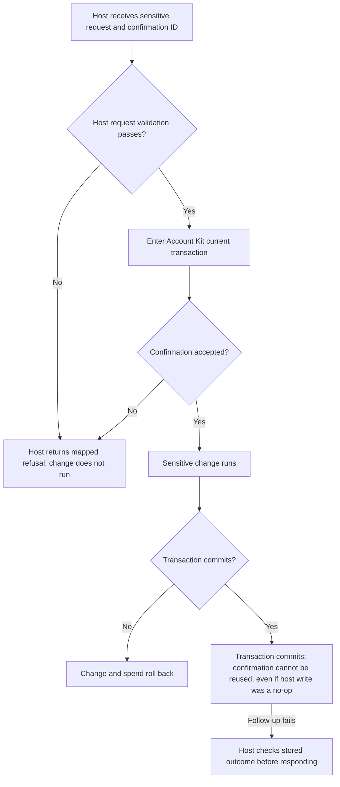
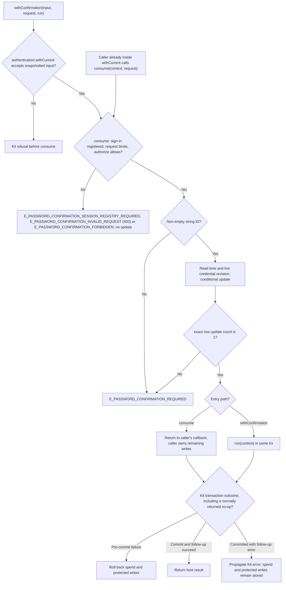

# US-CONFIRM-02 — Spend a confirmation with the sensitive change

As a signed-in account holder, I want the application to spend my confirmation with the exact operation it is bound to so that the proof cannot be reused or spent with a different change.

**Status:** Current, through the same Account Kit `withCurrent` transaction.
**Access:** A server-side session store is required (see [US-CONFIRM-01](US-CONFIRM-01-issue-confirmation.md)). The confirmation must belong to the current account and sign-in and match `operation`, `scope`, canonical intent hash, live credential revision, and expiry. If configured, the [host authorisation callback](US-CONFIRM-09-register-authorization.md) runs again. The host owns resource access.
**Entry:** Host protected operation calls `withConfirmation(input, request, run)`, or calls `consume(context, request)` inside its own `withCurrent` callback.
**Documentation:** [README use](../README.md#use)
**Source:** [`withConfirmation` and `consume`](../src/password_confirmations.ts)
**Coverage:** [`tests/password_confirmations.spec.ts`](../tests/password_confirmations.spec.ts)

## Acceptance criteria

- The host sends a non-empty confirmation ID and the same 1–255 character `operation`/`scope` strings plus the required canonicalisable JSON intent. There is no package form or route.
- A matching live confirmation is marked consumed before `run`; the mark and host change share the Kit transaction. A `run` that returns normally commits the spend even if its own update affects no rows.
- A missing, expired, consumed, mismatched or revoked confirmation is rejected; rollback of `run` also rolls back the spend. A request that fails binding (invalid `operation`, `scope` or `intent`, 400), has no registered sign-in, or fails host authorisation is refused before any row is updated.

- If Kit reports `E_ACCOUNT_KIT_POST_COMMIT` with `committed === true`, the spend and transaction writes are already stored. The host checks the stored outcome before deciding how to respond. [README errors](../README.md#errors)
- Both deadlines apply strictly. A larger configured window cannot extend the issued deadline and a shorter one applies immediately. Equality with either deadline refuses the spend. One conditional update must affect exactly one row, so competing callers cannot commit the same proof twice. `withConfirmation` returns the callback result and `consume` resolves without a value. The callback must write through `context.trx` for its changes to roll back with the spend.

## User flow

## Code flow

Scope: package service path; HTTP request validation, origin checks and response mapping remain host-owned.

**Code references:** [Methods](../src/password_confirmations.ts), [transaction context types](../src/types.ts)
