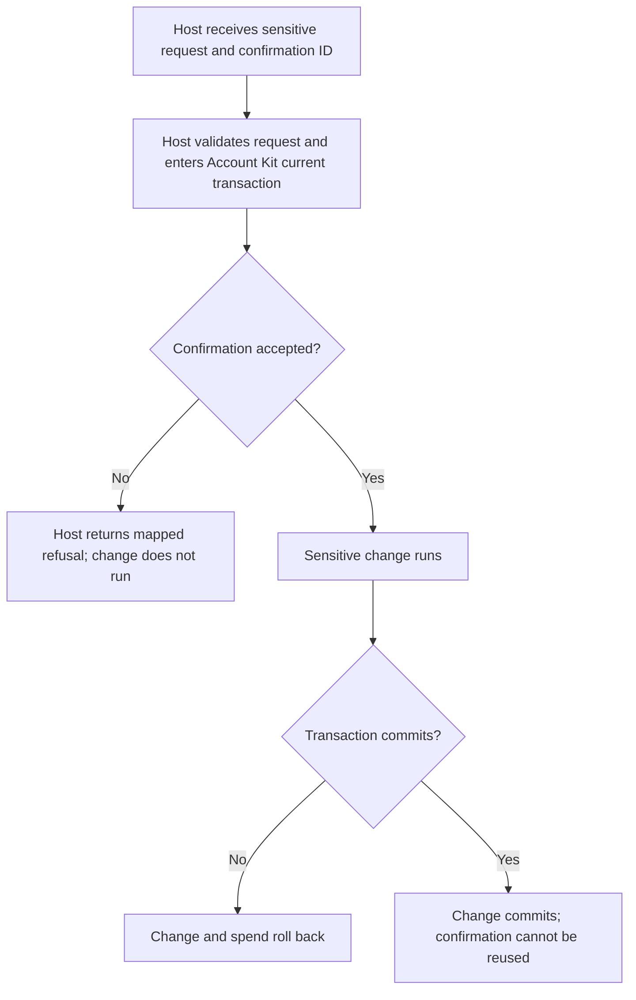
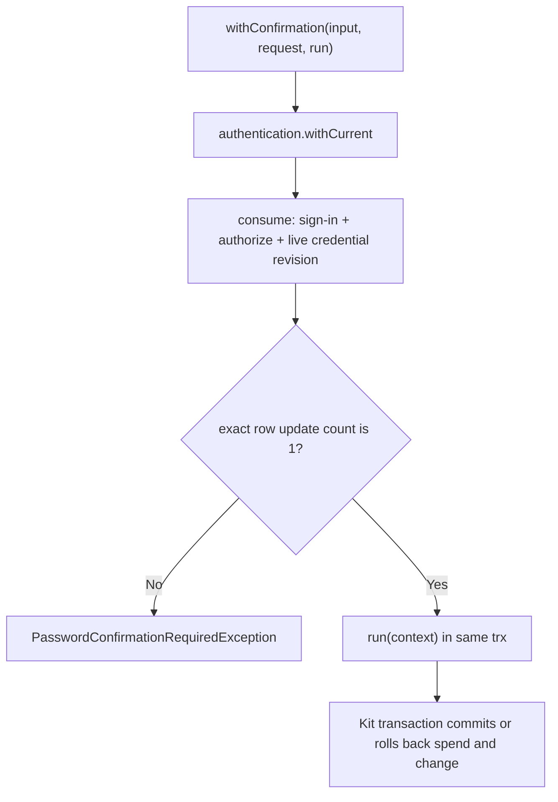

# US-CONFIRM-02 — Spend a confirmation with the sensitive change

As a signed-in account holder, I want the application to spend my confirmation with the exact operation it authorized so that the proof cannot authorize a different change or be reused.

**Status:** Current, through the same Account Kit `withCurrent` transaction.
**Access:** The confirmation must belong to the current account and sign-in and match action, scope, canonical intent hash, live credential revision, and expiry. Host policy is rerun.
**Entry:** Host protected action calls `withConfirmation(input, request, run)`, or calls `consume(context, request)` inside its own `withCurrent` callback.
**Documentation:** [README use](../README.md#use)
**Source:** [`withConfirmation` and `consume`](../src/password_confirmations.ts)
**Coverage:** [`tests/password_confirmations.spec.ts`](../tests/password_confirmations.spec.ts)

## Acceptance criteria

- The host sends the returned ID together with the same action, scope and intent. There is no package form or route.
- A matching live confirmation is marked consumed before `run`; the mark and host change share the Kit transaction.
- A missing, expired, consumed, mismatched, revoked or unauthorized confirmation is rejected; rollback of `run` also rolls back the spend.

## User flow

## Code flow

Scope: package service path; HTTP request validation, origin checks and response mapping remain host-owned.

**Code references:** [Methods](../src/password_confirmations.ts#L226), [transaction context types](../src/types.ts#L10)
