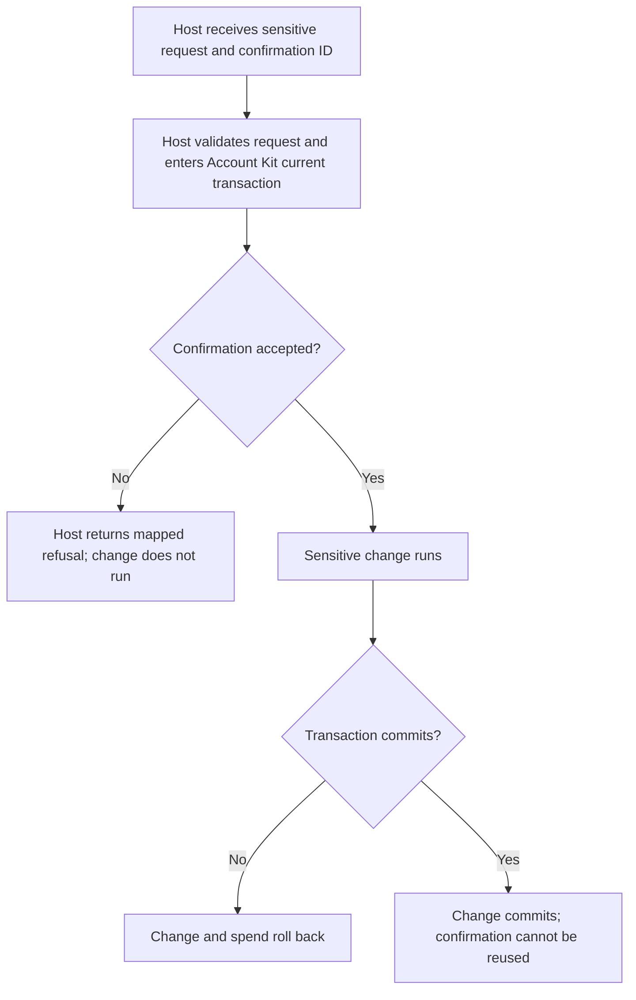
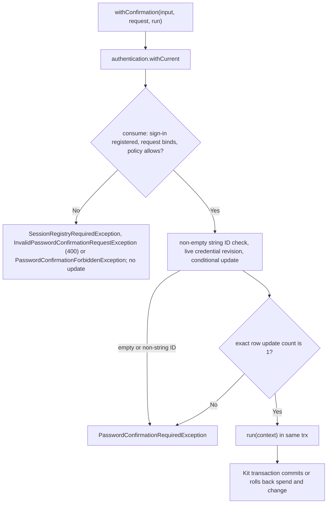

# US-CONFIRM-02 — Spend a confirmation with the sensitive change

As a signed-in account holder, I want the application to spend my confirmation with the exact operation it authorized so that the proof cannot authorize a different change or be reused.

**Status:** Current, through the same Account Kit `withCurrent` transaction.
**Access:** A server-side session store is required (see [US-CONFIRM-01](US-CONFIRM-01-issue-confirmation.md)). The confirmation must belong to the current account and sign-in and match action, scope, canonical intent hash, live credential revision, and expiry. Host policy is rerun.
**Entry:** Host protected action calls `withConfirmation(input, request, run)`, or calls `consume(context, request)` inside its own `withCurrent` callback.
**Documentation:** [README use](../README.md#use)
**Source:** [`withConfirmation` and `consume`](../src/password_confirmations.ts)
**Coverage:** [`tests/password_confirmations.spec.ts`](../tests/password_confirmations.spec.ts)

## Acceptance criteria

- The host sends a non-empty confirmation ID and the same 1–255 character action/scope strings plus the required canonicalizable JSON intent. There is no package form or route.
- A matching live confirmation is marked consumed before `run`; the mark and host change share the Kit transaction.
- A missing, expired, consumed, mismatched, revoked or unauthorized confirmation is rejected; rollback of `run` also rolls back the spend. A request that fails binding (invalid action, scope or intent, 400), has no registered sign-in, or fails host policy is refused before any row is updated.

## User flow

## Code flow

Scope: package service path; HTTP request validation, origin checks and response mapping remain host-owned.

**Code references:** [Methods](../src/password_confirmations.ts#L264), [transaction context types](../src/types.ts#L13)
