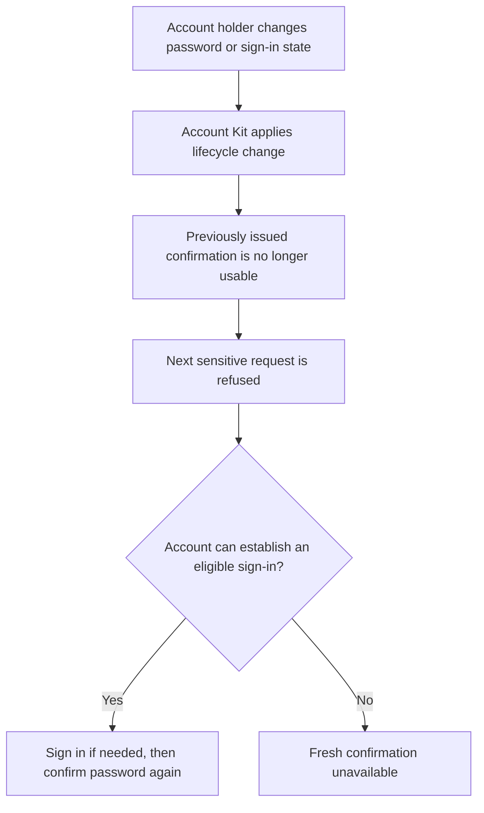
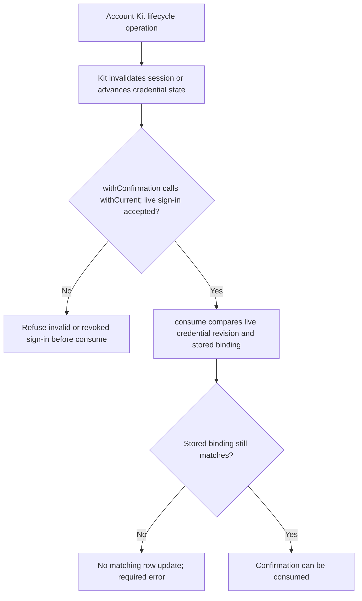

# US-CONFIRM-03 — Reject confirmations after account security changes

As an account holder, I want confirmations tied to my current sign-in and credential revision so that account security changes invalidate earlier proof.

**Status:** Current; invalidation follows Account Kit lifecycle changes.
**Access:** Current registered sign-in and unchanged credential revision are required at spend. Account Kit owns session expiry, revocation and credential updates. The logout guarantee needs a server-side session store, because the cookie store keeps a copied session alive ([US-CONFIRM-01](US-CONFIRM-01-issue-confirmation.md), [README requirements](../README.md#requirements)).
**Entry:** No separate control. The host observes refusal on the next protected operation; Account Kit lifecycle operations trigger invalidation.
**Documentation:** [README confirmation lifecycle](../README.md#what-ends-a-confirmation)
**Source:** [`consume`](../src/password_confirmations.ts), [Account Kit compatibility tests](../tests/revocation.spec.ts)
**Coverage:** [`tests/revocation.spec.ts`](../tests/revocation.spec.ts)

## Acceptance criteria

- Password change/reset, logout, session revocation, restriction changes, completed email change, account deletion, expiry, and a new sign-in in the same browser end outstanding confirmations as described in README.
- Spending requires the live credential revision and same live sign-in; otherwise the service refuses before or during confirmation consumption. Recover with an eligible sign-in, then fresh password confirmation; a deleted account cannot issue new proof.
- Social unlink and registration claim share Kit invalidation paths but are called out as not directly driven by tests in the README.

## User flow

## Code flow

Scope: package service path; HTTP request validation, origin checks and response mapping remain host-owned.

**Code references:** [Spend check](../src/password_confirmations.ts#L229), [revocation contract](../README.md#what-ends-a-confirmation), [revocation spec](../tests/revocation.spec.ts)
