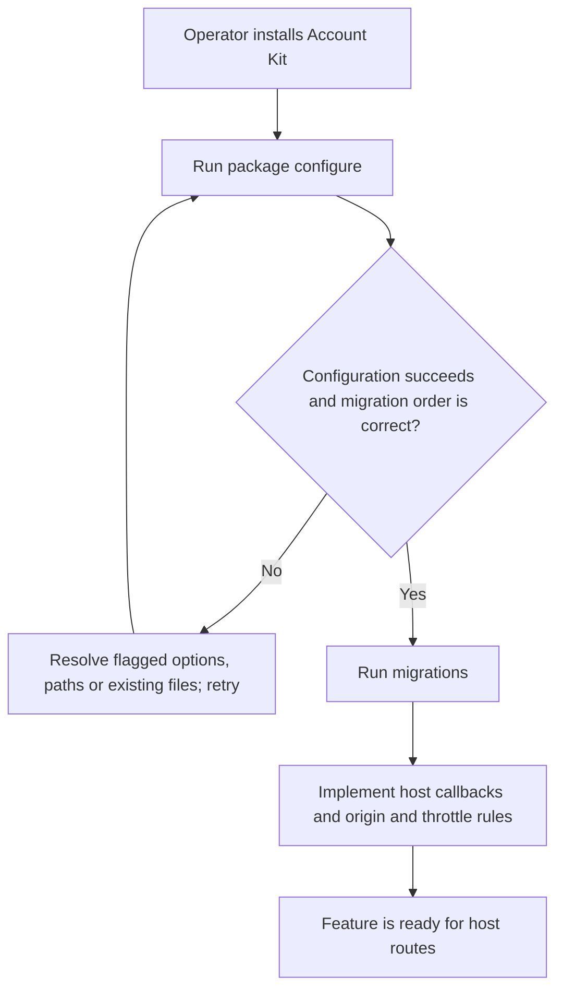
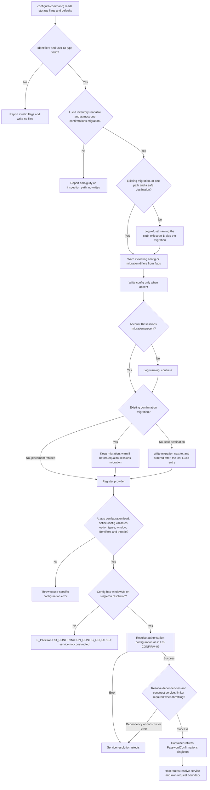

# US-CONFIRM-04 — Configure confirmation storage and provider

As an application operator, I want to install the provider and storage so that confirmation operations can run with their Account Kit dependencies.

**Status:** Operator.
**Access:** Application operator configures Account Kit first, using Assembler for codemods, registers package provider and runs migrations. Configure does not detect the session store; the application needs a server-side session store for the sign-out guarantee ([US-CONFIRM-01](US-CONFIRM-01-issue-confirmation.md), [README requirements](../README.md#requirements)).
**Entry:** `node ace configure @kevinjohn/adonisjs-confirm-action-with-password`.
**Documentation:** [Install](../README.md#install)
**Source:** [`configure`](../configure.ts)
**Coverage:** [`tests/configure.spec.ts`](../tests/configure.spec.ts)

## Acceptance criteria

- Configure accepts these storage options:

| Option           | Control    | Required/default/conditions                                                                                       |
| ---------------- | ---------- | ----------------------------------------------------------------------------------------------------------------- |
| `--users-table`  | CLI option | Optional; defaults to `users`; must be a plain SQL identifier matching `[A-Za-z_][A-Za-z0-9_]*`.                  |
| `--user-id-type` | CLI option | Optional; `integer` (default), `string` or `uuid`; selects the generated migration's user ID column type.         |
| `--table`        | CLI option | Optional; defaults to `password_confirmations`; must be a plain SQL identifier matching `[A-Za-z_][A-Za-z0-9_]*`. |

- Configure writes config, migration and provider without overwriting files; invalid option values and non-missing inspection failures prevent those writes. It uses the primary Lucid connection's single migration path or AdonisJS's migration directory if not set. With multiple primary migration paths it looks for an existing confirmations migration in all of them. It preserves existing Lucid migration identities, including nested paths. A new migration goes next to the last Lucid-discoverable migration and must sort after it. If the paths are ambiguous with no existing migration, or the placement is unsafe, configure still writes the config and provider, skips the migration, logs an error naming the stub and exits with code 1 so the operator installs it manually ([manual migration](../README.md#install-the-migration-manually)). If Lucid has no Account Kit `account_sessions` migration, configure logs a warning and continues. Interrupted writes remain recoverable using the [setup guidance](../README.md#install).
- `config/password_confirmations.ts` (`defineConfig`) accepts these options:

| Option             | Control                | Required/default/conditions                                                                                                                                                                                                                 |
| ------------------ | ---------------------- | ------------------------------------------------------------------------------------------------------------------------------------------------------------------------------------------------------------------------------------------- |
| `window`           | Duration string/number | Optional; default `5m`; must parse to a positive safe-integer number of milliseconds.                                                                                                                                                       |
| `table`            | Config string          | Optional; default `password_confirmations`; plain SQL identifier; must match the generated migration.                                                                                                                                       |
| `usersTable`       | Config string          | Optional; default `users`; plain SQL identifier.                                                                                                                                                                                            |
| `readPasswordHash` | Callback               | Optional; receives `userId` and `trx`; default reads the `password` column of `usersTable` through the Kit transaction. Return hash or null.                                                                                                |
| `verifyPassword`   | Callback               | Optional; receives hash and password; default is the application's hash service; return false for a wrong password.                                                                                                                         |
| `authorize`        | Callback               | Optional; receives context and `{ action, scope, intent }` only; optional here when registered from a host provider. The service allows by default when both sources omit it. See [US-CONFIRM-09](US-CONFIRM-09-register-authorization.md). |
| `throttle`         | Object or `false`      | Optional; defaults 5 `requests`, `duration` `'1 minute'`, `blockDuration` `'20 minutes'`; `requests` must be a positive safe integer and each duration must parse to a positive safe-integer number of seconds; `false` turns it off.       |

- `defineConfig` refuses wrong JavaScript types when the config loads, with a cause-specific code naming the key: `E_PASSWORD_CONFIRMATION_INVALID_CONFIG` for a non-object config, `E_PASSWORD_CONFIRMATION_INVALID_TABLE` for table names, `E_PASSWORD_CONFIRMATION_INVALID_CALLBACK` for callbacks, `E_PASSWORD_CONFIRMATION_INVALID_THROTTLE` for throttle shape, `E_PASSWORD_CONFIRMATION_INVALID_BUDGET` for its request count, and `E_PASSWORD_CONFIRMATION_INVALID_DURATION` for duration syntax or range. An absent (`undefined` or `null`) option takes its default when the config sets one. A missing `authorize` stays unset during config validation. A duration that fails to parse keeps the parser's error as `cause`. [Config validation](../src/define_config.ts) · [Spec](../tests/define_config.spec.ts)
- Throttling needs `@adonisjs/limiter` registered unless `throttle` is `false`; otherwise constructing the service fails with `E_PASSWORD_CONFIRMATION_LIMITER_REQUIRED`. The provider refuses a config object without `windowMs` with `E_PASSWORD_CONFIRMATION_CONFIG_REQUIRED` before resolving the callback registry.
- The provider binds the package service to Account Kit, Lucid and application hash/limiter dependencies. HTTP routes, origin checks and response mapping remain host-owned.
- Custom `readPasswordHash` and `authorize` callbacks use only their supplied transaction and avoid side effects: Account Kit may retry them. Authorisation treats the intent as read-only.

- A host using string user IDs can add its own foreign key and cascade rules for resource scope. The host compatibility fixture checks isolation across scopes and continued spending on the surviving scope. The package leaves resource ownership and authorisation to the host. [Host compatibility](../tests/host_compatibility.spec.ts)

## User flow

## Code flow

Scope: setup path; HTTP request validation, origin checks and response mapping remain host-owned.

**Code references:** [Configure and migration inspection](../configure.ts), [SQL identifier rule](../src/sql_identifier.ts), [config types](../src/types.ts), [config validation](../src/define_config.ts), [provider](../providers/password_confirmations_provider.ts), [limiter requirement](../src/password_confirmations.ts)
