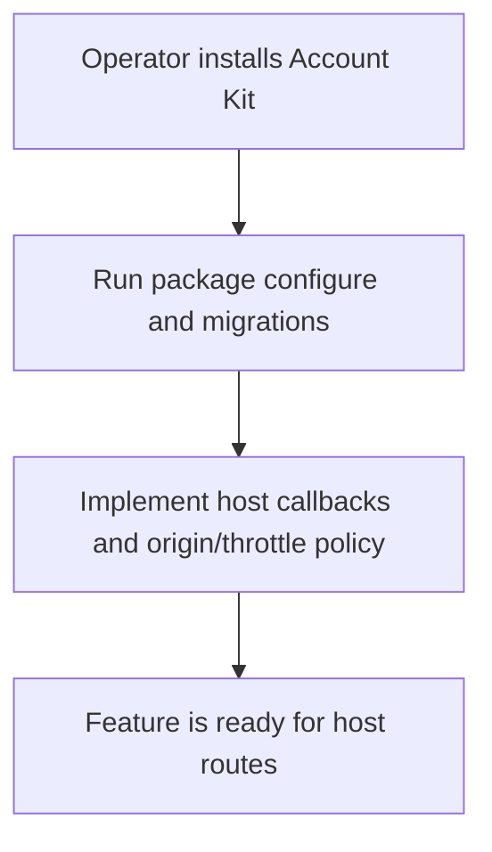
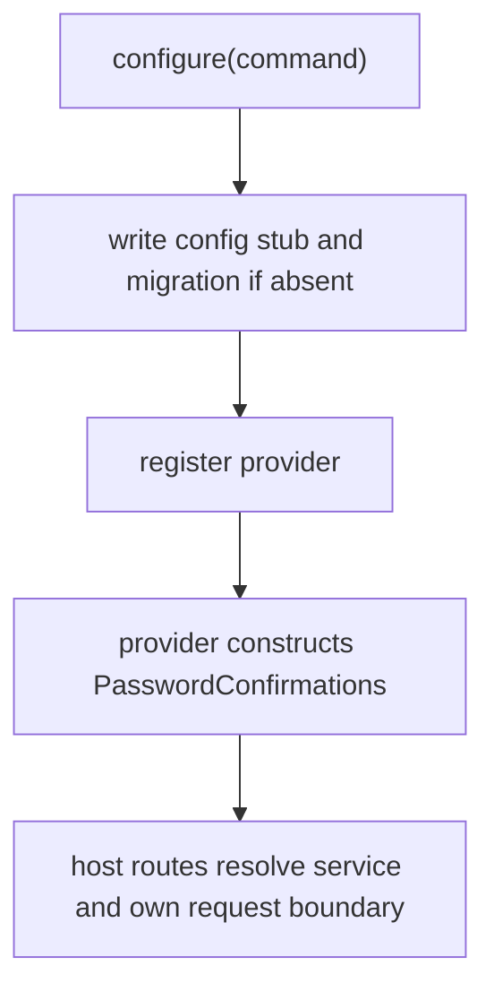

# US-CONFIRM-04 — Configure confirmation storage and provider

As an application operator, I want to install the provider and storage so that confirmation operations can run with their Account Kit dependencies.

**Status:** Operator.
**Access:** Application operator configures Account Kit first, registers package provider and runs migrations.
**Entry:** `node ace configure @kevinjohn/adonisjs-confirm-action-with-password`.
**Documentation:** [Install](../README.md#install)
**Source:** [`configure`](../configure.ts)
**Coverage:** [`tests/configure.spec.ts`](../tests/configure.spec.ts)

## Acceptance criteria

- Configure writes config, migration and provider without overwriting files; its migration must sort after Account Kit `account_sessions`.
- Default confirmation window is 5 minutes. The host can configure table names, password read/verify callbacks, authorization callback and throttling.
- The provider binds the package service to Account Kit, Lucid and application hash/limiter dependencies. HTTP routes, origin checks and response mapping remain host-owned.

## User flow

## Code flow

Scope: setup path; HTTP request validation, origin checks and response mapping remain host-owned.

**Code references:** [Configure](../configure.ts), [config types](../src/types.ts#L39), [provider](../providers/password_confirmations_provider.ts)
