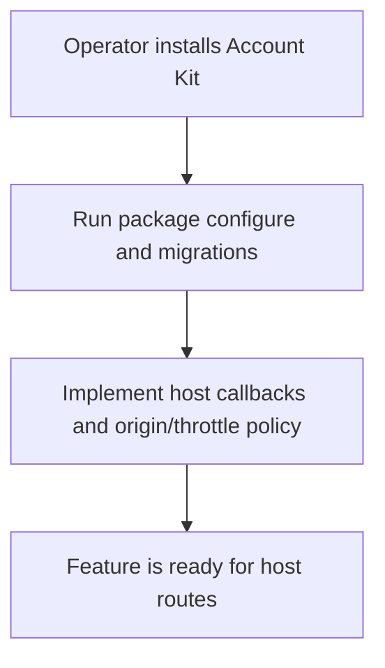
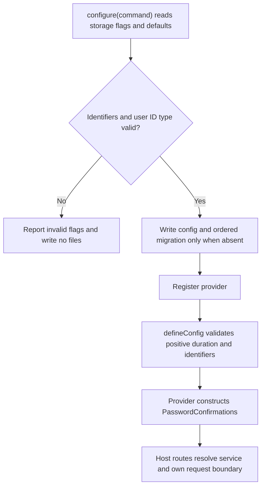

# US-CONFIRM-04 — Configure confirmation storage and provider

As an application operator, I want to install the provider and storage so that confirmation operations can run with their Account Kit dependencies.

**Status:** Operator.
**Access:** Application operator configures Account Kit first, registers package provider and runs migrations.
**Entry:** `node ace configure @kevinjohn/adonisjs-confirm-action-with-password`.
**Documentation:** [Install](../README.md#install)
**Source:** [`configure`](../configure.ts)
**Coverage:** [`tests/configure.spec.ts`](../tests/configure.spec.ts)

## Acceptance criteria

- Configure accepts these storage options:

| Option           | Control    | Required/default/conditions                                                                                       |
| ---------------- | ---------- | ----------------------------------------------------------------------------------------------------------------- |
| `--users-table`  | CLI option | Optional; defaults to `users`; must be a plain SQL identifier matching `[A-Za-z_][A-Za-z0-9_]*`.                  |
| `--user-id-type` | CLI option | Optional; `integer` (default), `string` or `uuid`; selects the generated migration's user ID column type.         |
| `--table`        | CLI option | Optional; defaults to `password_confirmations`; must be a plain SQL identifier matching `[A-Za-z_][A-Za-z0-9_]*`. |

- Configure writes config, migration and provider without overwriting files; invalid option values prevent those writes. Its migration must sort after Account Kit `account_sessions`.
- The config `window` accepts a duration string or number, defaults to `5m`, and must parse to a positive duration. The host can also configure password read/verify callbacks, authorization callback and throttling.
- The provider binds the package service to Account Kit, Lucid and application hash/limiter dependencies. HTTP routes, origin checks and response mapping remain host-owned.

## User flow

## Code flow

Scope: setup path; HTTP request validation, origin checks and response mapping remain host-owned.

**Code references:** [Configure](../configure.ts), [SQL identifier rule](../src/sql_identifier.ts), [config types](../src/types.ts#L52), [config validation](../src/define_config.ts), [provider](../providers/password_confirmations_provider.ts)
