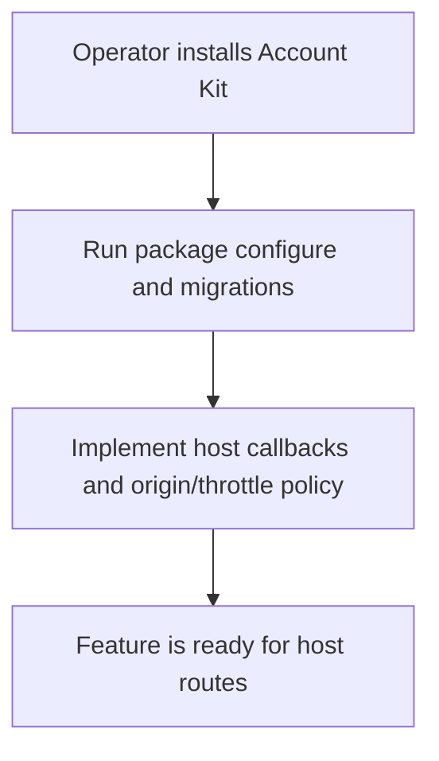
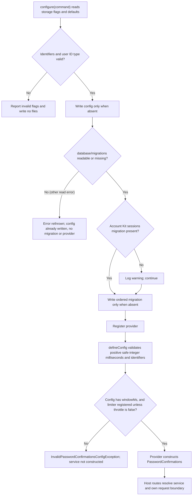

# US-CONFIRM-04 — Configure confirmation storage and provider

As an application operator, I want to install the provider and storage so that confirmation operations can run with their Account Kit dependencies.

**Status:** Operator.
**Access:** Application operator configures Account Kit first, registers package provider and runs migrations. Configure does not detect the session store; the application needs a server-side session store for the logout guarantee ([US-CONFIRM-01](US-CONFIRM-01-issue-confirmation.md), [README requirements](../README.md#requirements)).
**Entry:** `node ace configure @kevinjohn/adonisjs-confirm-action-with-password`.
**Documentation:** [Install](../README.md#install)
**Source:** [`configure`](../configure.ts)
**Coverage:** [`tests/configure.spec.ts`](../tests/configure.spec.ts)

## Acceptance criteria

- Configure accepts these storage options:

| Option           | Control    | Required/default/conditions                                                                                       |
| ---------------- | ---------- | ----------------------------------------------------------------------------------------------------------------- |
| `--users-table`  | CLI option | Optional; defaults to `users`; must be a plain SQL identifier matching `[A-Za-z_][A-Za-z0-9_]*`.                  |
| `--user-id-type` | CLI option | Optional; `integer` (default), `string` or `uuid`; selects the generated migration's user ID column type.         |
| `--table`        | CLI option | Optional; defaults to `password_confirmations`; must be a plain SQL identifier matching `[A-Za-z_][A-Za-z0-9_]*`. |

- Configure writes config, migration and provider without overwriting files; invalid option values prevent those writes. Config is written first, so an unexpected error reading `database/migrations` leaves the config file without the migration or provider. Its migration must sort after Account Kit `account_sessions`; configure does not enforce this: when no `*_account_kit_create_account_sessions.ts` migration exists it logs a warning and still writes the files.
- `config/password_confirmations.ts` (`defineConfig`) accepts these options:

| Option             | Control                | Required/default/conditions                                                                                                                                 |
| ------------------ | ---------------------- | ----------------------------------------------------------------------------------------------------------------------------------------------------------- |
| `window`           | Duration string/number | Optional; default `5m`; must parse to a positive safe-integer number of milliseconds.                                                                       |
| `table`            | Config string          | Optional; default `password_confirmations`; plain SQL identifier; must match the generated migration.                                                       |
| `usersTable`       | Config string          | Optional; default `users`; plain SQL identifier.                                                                                                            |
| `readPasswordHash` | Callback               | Optional; default reads the `password` column of `usersTable` through the Kit transaction.                                                                  |
| `verifyPassword`   | Callback               | Optional; default is the application's hash service; return false for a wrong password.                                                                     |
| `authorize`        | Callback               | Optional; default allows every request; anything other than `true` refuses.                                                                                 |
| `throttle`         | Object or `false`      | Optional; defaults 5 `requests`, `duration` `'1 minute'`, `blockDuration` `'20 minutes'`; `requests` must be a positive safe integer; `false` turns it off. |

- Throttling needs `@adonisjs/limiter` registered unless `throttle` is `false`; otherwise constructing the service fails with `InvalidPasswordConfirmationsConfigException`. The provider also refuses a config object without `windowMs`.
- The provider binds the package service to Account Kit, Lucid and application hash/limiter dependencies. HTTP routes, origin checks and response mapping remain host-owned.

## User flow

## Code flow

Scope: setup path; HTTP request validation, origin checks and response mapping remain host-owned.

**Code references:** [Configure](../configure.ts), [SQL identifier rule](../src/sql_identifier.ts), [config types](../src/types.ts#L53), [config validation](../src/define_config.ts), [provider](../providers/password_confirmations_provider.ts#L31), [limiter requirement](../src/password_confirmations.ts#L71), [migrations read](../configure.ts#L55), [missing-migration warning](../configure.ts#L61)
