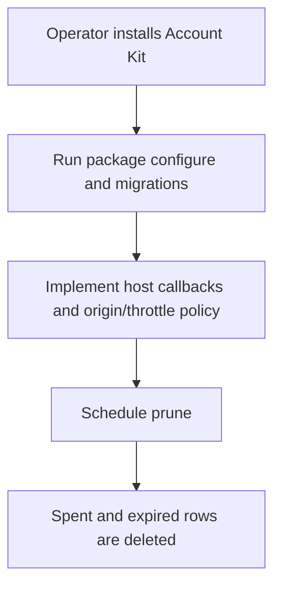
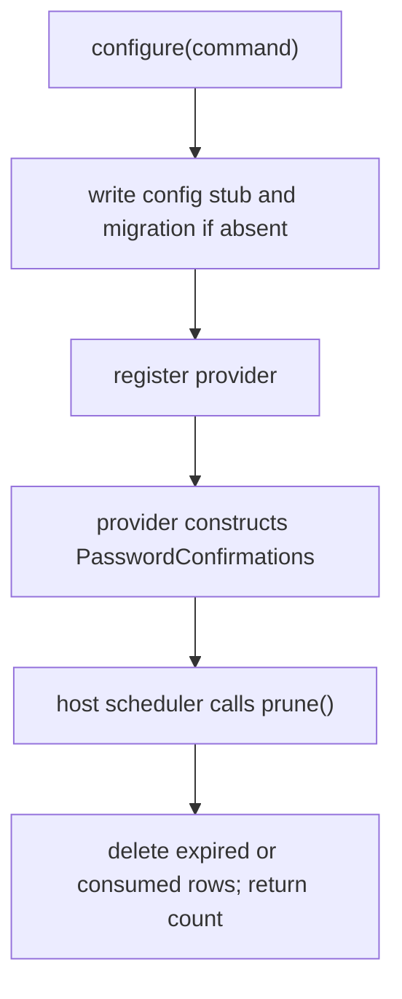

# US-CONFIRM-04 — Configure confirmation storage and prune old rows

As an application operator, I want to install the provider and storage and periodically remove spent or expired confirmations so that the feature can run and its table does not retain obsolete rows indefinitely.

**Status:** Operator.
**Access:** Application operator configures Account Kit first, registers package provider, runs migrations, sets policy/throttle, and schedules `prune()`.
**Entry:** `node ace configure @kevinjohn/adonisjs-confirm-action-with-password`; recurring host scheduler calls `passwordConfirmations.prune()`.
**Documentation:** [Install and host rules](../README.md#install)
**Source:** [`configure`](../configure.ts), [`prune`](../src/password_confirmations.ts)
**Coverage:** [`tests/configure.spec.ts`](../tests/configure.spec.ts), [`tests/revocation.spec.ts`](../tests/revocation.spec.ts)

## Acceptance criteria

- Configure writes config, migration and provider without overwriting files; its migration must sort after Account Kit `account_sessions`.
- Default window is 5 minutes; host can configure `window`, table/users table, password readers/verifier, `authorize`, and throttle.
- `prune()` removes rows whose verified time is at/before the window cutoff or whose `consumed_at` is non-null and returns the removed-row count. No built-in scheduler exists.

## User flow

## Code flow

Scope: package service path; HTTP request validation, origin checks and response mapping remain host-owned.

**Code references:** [Configure](../configure.ts), [config types](../src/types.ts#L39), [provider](../providers/password_confirmations_provider.ts), [pruning](../src/password_confirmations.ts#L244)
