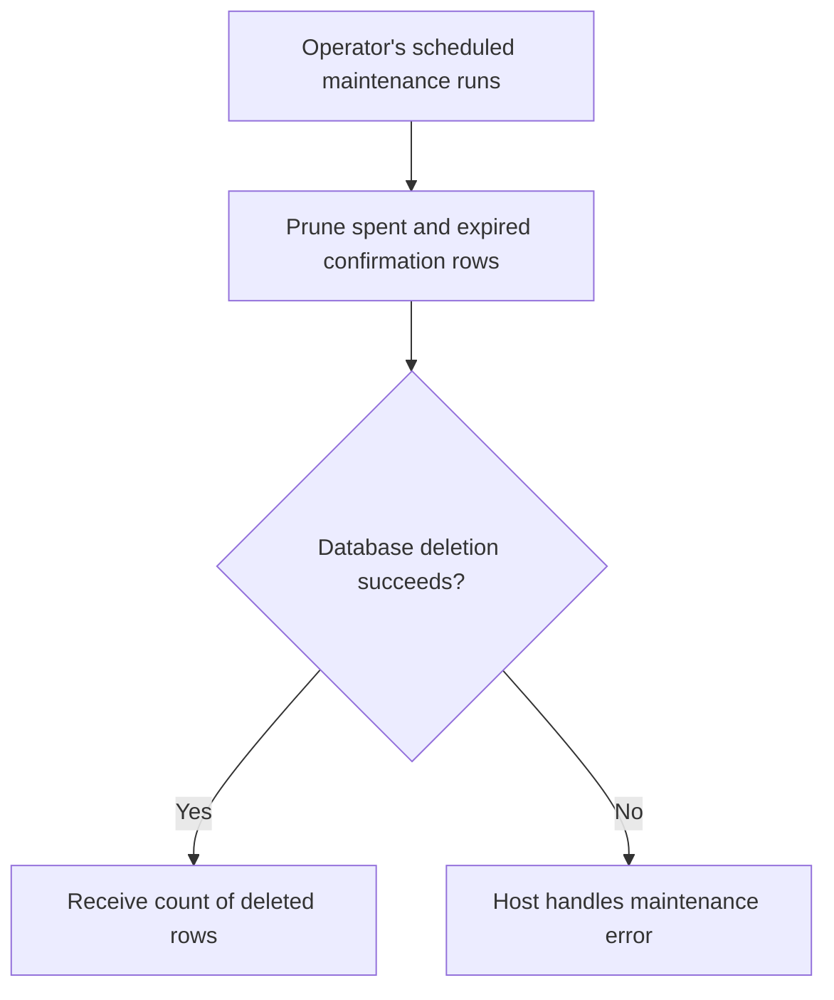
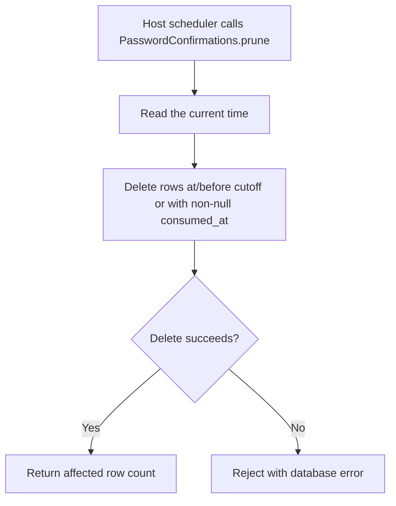

# US-CONFIRM-05 — Remove spent or expired confirmations

As an application operator, I want to remove spent and expired confirmations so that obsolete rows do not accumulate in the confirmation table.

**Status:** Operator.
**Access:** Application scheduler/operator invokes the public service's `prune()` method.
**Entry:** Host scheduler calls `passwordConfirmations.prune()`; no package command or scheduler is provided.
**Documentation:** [README use](../README.md#use)
**Source:** [`PasswordConfirmations.prune`](../src/password_confirmations.ts)
**Coverage:** [`tests/password_confirmations.spec.ts`](../tests/password_confirmations.spec.ts)

## Acceptance criteria

- `prune()` deletes rows whose stored `expires_at` deadline has passed, plus rows with a non-null `consumed_at`. The deadline is fixed at issue, so the window configured for the pruning process does not change which rows are expired.
- The method returns the number of deleted rows. The host chooses and schedules a cadence appropriate to its storage and operations.

- Equality with the stored deadline qualifies for deletion. Running the operation again returns zero if there are no further qualifying rows. Issuance also cleans spent or expired rows for that sign-in only.

## User flow

## Code flow

Scope: package deletion method; scheduler and cadence are host-owned.

**Code references:** [prune method](../src/password_confirmations.ts), [window configuration](../src/types.ts)
