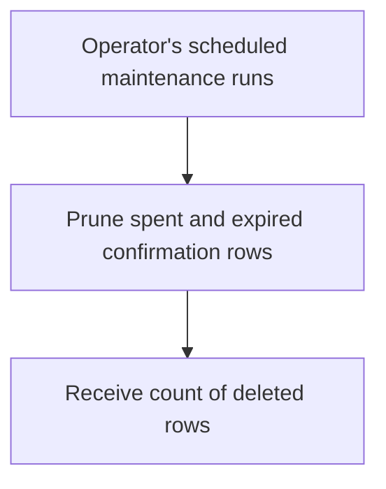
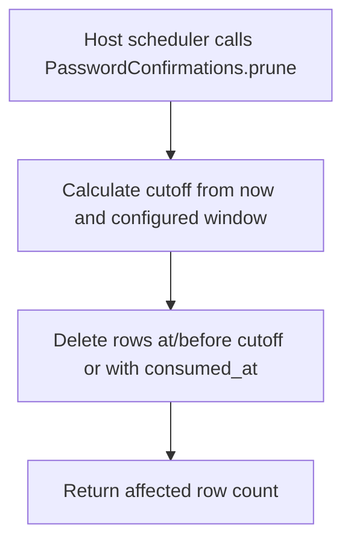

# US-CONFIRM-05 — Remove spent or expired confirmations

As an application operator, I want to remove spent and expired confirmations so that obsolete rows do not accumulate in the confirmation table.

**Status:** Operator.
**Access:** Application scheduler/operator invokes the public service's `prune()` method.
**Entry:** Host scheduler calls `passwordConfirmations.prune()`; no package command or scheduler is provided.
**Documentation:** [README use](../README.md#use)
**Source:** [`PasswordConfirmations.prune`](../src/password_confirmations.ts)
**Coverage:** [`tests/revocation.spec.ts`](../tests/revocation.spec.ts)

## Acceptance criteria

- `prune()` deletes rows whose `verified_at` is at or before the configured window cutoff, plus rows with a non-null `consumed_at`.
- The method returns the number of deleted rows. The host chooses and schedules a cadence appropriate to its storage and operations.

## User flow

## Code flow

Scope: package deletion method; scheduler and cadence are host-owned.

**Code references:** [prune method](../src/password_confirmations.ts#L276), [window configuration](../src/types.ts#L39)
