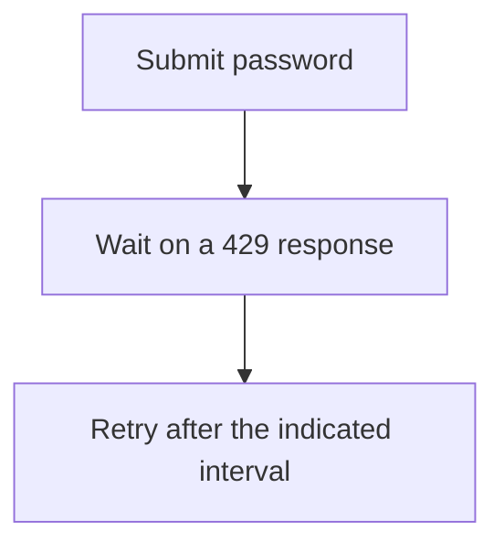
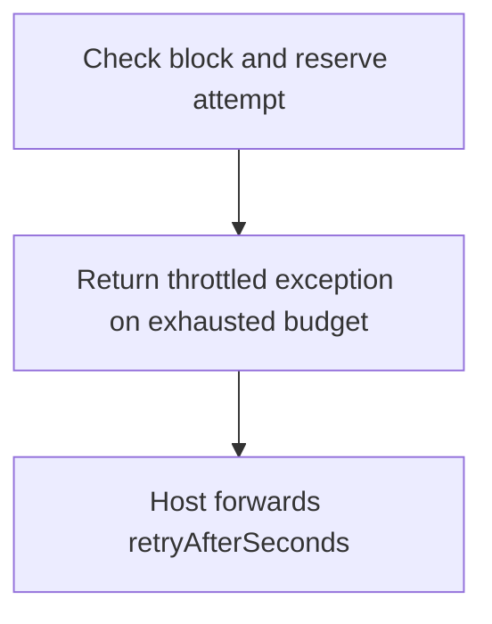

# US-CONFIRM-06 — Recover from password-check throttling

As a signed-in account holder, I want to know when I can try my password again so that I can complete the protected operation after the block expires.

**Status:** Current.
**Access:** The host uses the package limiter and exposes an exception handler.
**Entry:** Retry the host confirmation request after a 429 response.
**Documentation:** [Package guide](../README.md)
**Source:** [Implementation](../src/password_confirmations.ts)
**Coverage:** [Regression evidence](../tests/throttle.spec.ts)

## Acceptance criteria

- Issuance reserves an account-wide slot before running a password hash. Parallel checks and multiple sign-ins share the budget. Hosts sharing the database limiter also share blocks across app instances. Another account keeps its own budget. [Database limiter fixtures](../tests/host_compatibility.spec.ts)
- In-flight reservations can exhaust the budget before any wrong password completes. Completed wrong passwords count towards the block. Throttled retries leave the existing deadline intact. A correct password resets the attempt and failure counts. A verifier exception refunds its reservation. If refund also fails, an AggregateError carries both causes.
- The exception exposes `retryAfterSeconds`. The host sets the HTTP `Retry-After` header and delegates to its normal exception handler to preserve content negotiation. A timed retry still requires a current sign-in, permission and the right password. With `throttle: false` the host owns its throttle policy.

## User flow

## Code flow

**Code references:** [Implementation](../src/password_confirmations.ts), [regression evidence](../tests/throttle.spec.ts).
