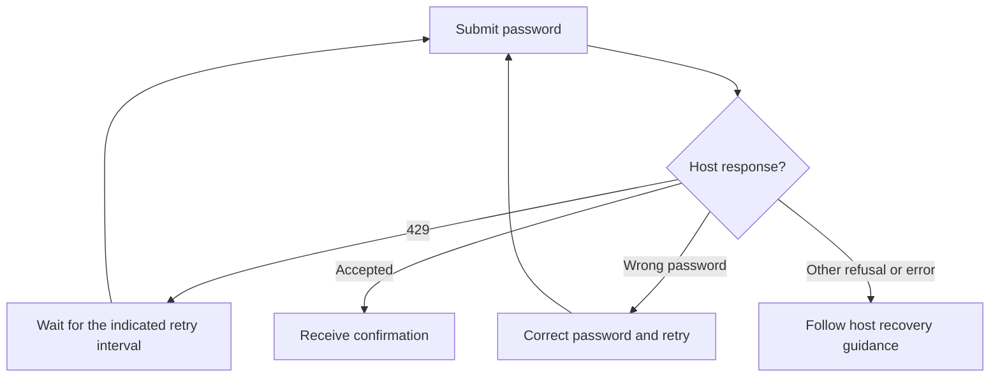
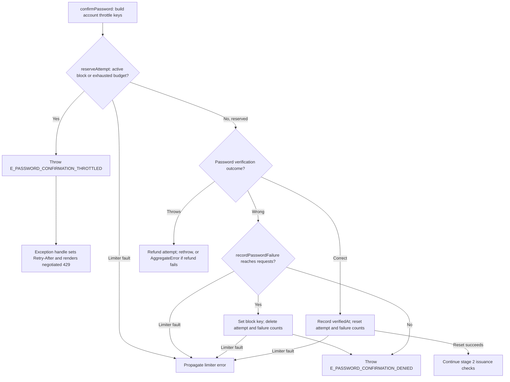

# US-CONFIRM-06 — Recover from password-check throttling

As a signed-in account holder, I want to know when I can try my password again so that I can complete the protected operation after the block expires.

**Status:** Current.
**Access:** The host uses the package limiter and exposes an exception handler.
**Entry:** Retry the host confirmation request after a 429 response.
**Documentation:** [Package guide](../README.md)
**Source:** [Implementation](../src/password_confirmations.ts)
**Coverage:** [Regression evidence](../tests/throttle.spec.ts)

## Acceptance criteria

- Issuance reserves an account-wide slot before running a password hash. Parallel checks and multiple sign-ins share the budget when they use the same limiter store. Hosts sharing a limiter store also share blocks across app instances; memory stores have separate per-process budgets. Another account keeps its own budget. [Database limiter fixtures](../tests/host_compatibility.spec.ts)
- In-flight reservations can exhaust the budget before any wrong password completes. Completed wrong passwords count towards the block. Throttled retries leave the existing deadline intact. A correct password resets the attempt and failure counts. A verifier exception refunds its reservation. If refund also fails, an AggregateError carries both causes.
- The exception exposes `retryAfterSeconds`. The exception sets the HTTP `Retry-After` header and renders the negotiated response. A timed retry still requires a current sign-in, permission and the right password. With `throttle: false` the host owns its throttle rules.

## User flow

## Code flow

Scope: package limiter-enabled path after the first `withCurrent` stage. The exception handles its negotiated response through the [HTTP exception handler](../README.md#errors), and a correct password resumes [issuance at stage two](US-CONFIRM-01-issue-confirmation.md#code-flow).

**Code references:** [Implementation](../src/password_confirmations.ts), [regression evidence](../tests/throttle.spec.ts).
