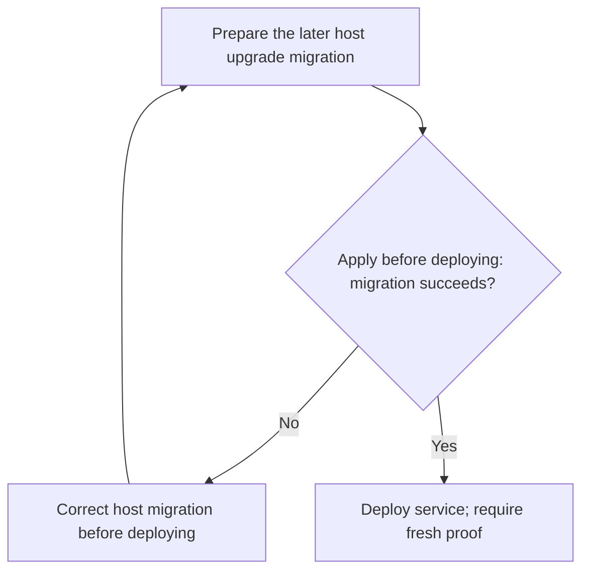
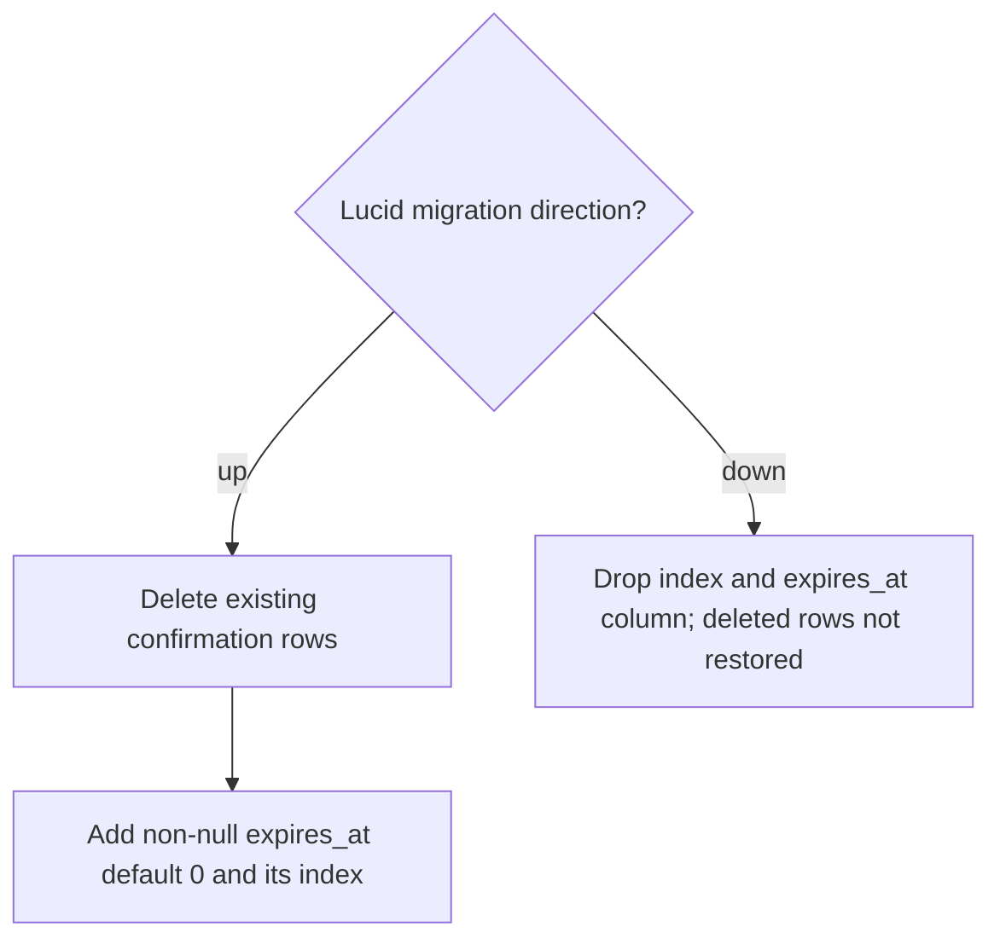

# US-CONFIRM-07 — Upgrade existing confirmation storage

As a host operator, I want to upgrade an already migrated 0.1.1 table so that the service can enforce a stored deadline for every new confirmation.

**Status:** Operator.
**Access:** An existing host has already applied the 0.1.1 create migration.
**Entry:** Run a new host migration before deploying the service that reads expires_at.
**Documentation:** [Package guide](../README.md)
**Source:** [Host migration example](../CHANGELOG.md#upgrade-the-confirmations-table-from-011)
**Coverage:** [Regression evidence](../tests/schema_upgrade.spec.ts)

## Acceptance criteria

- Create a later migration from the changelog upgrade example, using the configured table name. Re-running configure preserves the original migration and cannot upgrade a table that Lucid already records as migrated.
- Run `node ace migration:run`. The migration removes existing proofs and adds a non-null indexed `expires_at` with default zero. Account holders must confirm again. The down migration drops the index and column. It cannot restore deleted proofs.

## User flow

## Code flow

Scope: changelog's host migration example, not a package command.

**Code references:** [Implementation](../CHANGELOG.md), [regression evidence](../tests/schema_upgrade.spec.ts).
