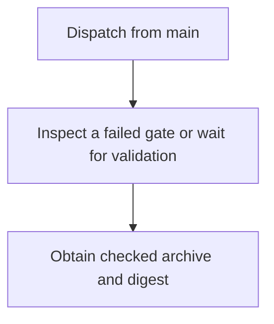
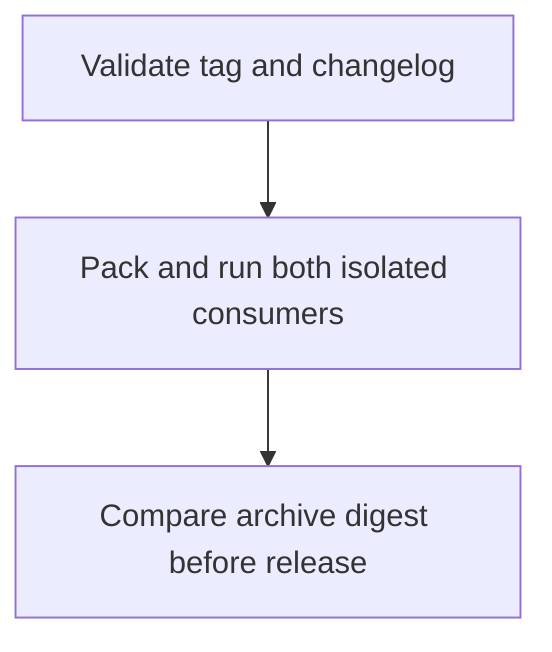

# US-CONFIRM-08 — Verify and release the candidate archive

As a package maintainer, I want to exercise the exact release archive in installed hosts so that consumers receive the bytes validated by the release gate.

**Status:** Operator.
**Access:** Release workflow dispatch on main and permission to create the prerelease.
**Entry:** Dispatch the release workflow, or exercise its package gate locally with bash bin/release_check.sh.
**Documentation:** [Package guide](../README.md)
**Source:** [Implementation](../bin/release_check.sh)
**Coverage:** [Regression evidence](../tests/tooling/release_check.spec.ts)

## Acceptance criteria

- An existing version tag, missing date-stamped version heading or populated Unreleased section stops the gate. After building and packing, record the archive SHA-256. A failed host run or changed digest prevents release.
- Independent hosts install the candidate under TypeScript 5.9.3 and 6.0.3 with strict peer installation. They verify packed exports and stubs, run configure and migrations, resolve the provider and public singleton, issue a confirmation, spend it once, reject reuse and type-check the host. [Consumer runner](../bin/test_packed_consumer.mjs) · [Host assertions](../examples/packed-consumer/host.ts)
- The workflow transfers the checked archive and generated notes to the release job. It creates a GitHub prerelease at the workflow commit with the install URL and checksum. Running the package gate locally only prepares the files. [Release workflow](../.github/workflows/release.yml)

## User flow

## Code flow

**Code references:** [Implementation](../bin/release_check.sh), [regression evidence](../tests/tooling/release_check.spec.ts).
