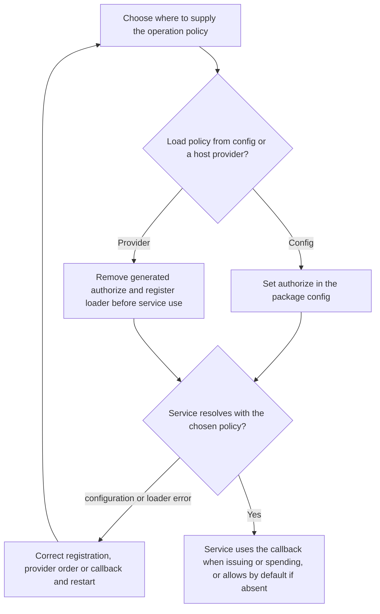
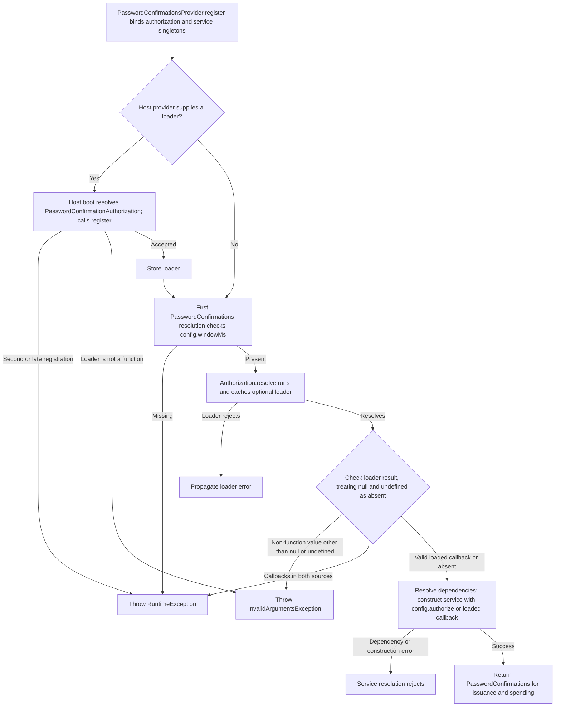

# US-CONFIRM-09 — Configure operation authorisation

As a host application developer, I want to provide the service with an authorization callback so that it checks permission for the operation at issuance and spend.

**Status:** Operator.
**Access:** Host developer who controls package config or provider boot. Provider registration requires access to the AdonisJS container before the service is first resolved.
**Entry:** Set `authorize` in `config/password_confirmations.ts` or call `register(load)` on the `PasswordConfirmationAuthorization` class binding in a host provider's `boot()`.
**Documentation:** [Registering callbacks from a provider](../README.md#registering-callbacks-from-a-provider).
**Source:** [Authorization](../src/authorization.ts), [provider](../providers/password_confirmations_provider.ts).
**Coverage:** [Authorization integration tests](../tests/authorization.spec.ts).

## Acceptance criteria

- The generated config includes `authorize: async () => true`. Remove that setting to supply the authorization callback via the loader. Configure preserves an existing config on reruns.
- `register(load)` takes one zero-argument loader that returns the callback or `undefined` synchronously or through a promise. List the host provider before any provider whose `boot()` resolves `PasswordConfirmations`. The class rejects a second registration and rejects registration after resolution begins. The provider calls the loader at first service resolution and the class caches that promise, including any rejection.
- The provider treats an omitted callback or a `null` value from untyped code as absent. Service resolution fails with `InvalidArgumentsException` if the loader returns a non-null, non-undefined value that is not a function. It fails with `RuntimeException` if both sources supply a callback. The service allows the permission check by default when neither source provides a callback.
- The authorization callback receives `KitContext` and `{ operation, scope, intent }`. It runs in the Kit transaction at both issuance stages and during spend. Only literal `true` permits the operation. Use the supplied transaction for reads, leave the intent unchanged and keep the callback safe to rerun.

## User flow

## Code flow

Scope: callback registration and provider merge. Issuance and spending call the resulting policy as traced in [US-CONFIRM-01](US-CONFIRM-01-issue-confirmation.md#code-flow) and [US-CONFIRM-02](US-CONFIRM-02-spend-confirmation.md#code-flow).

**Code references:** [Provider merge](../providers/password_confirmations_provider.ts#L32), [authorization](../src/authorization.ts#L33), [config stub](../stubs/config/password_confirmations.stub), [permission check](../src/password_confirmations.ts#L93).
